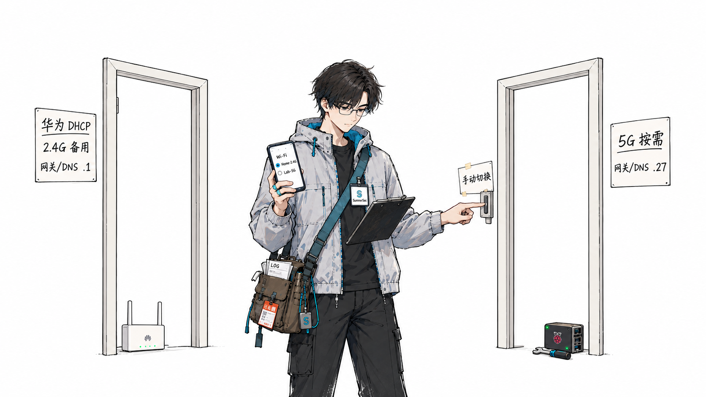
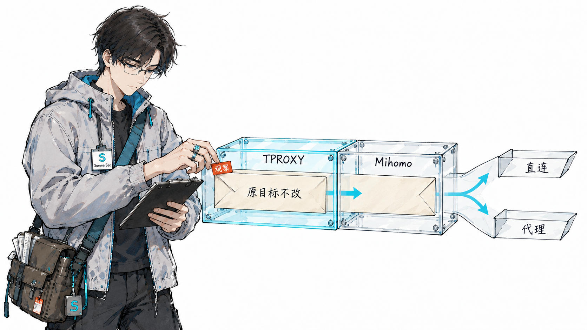
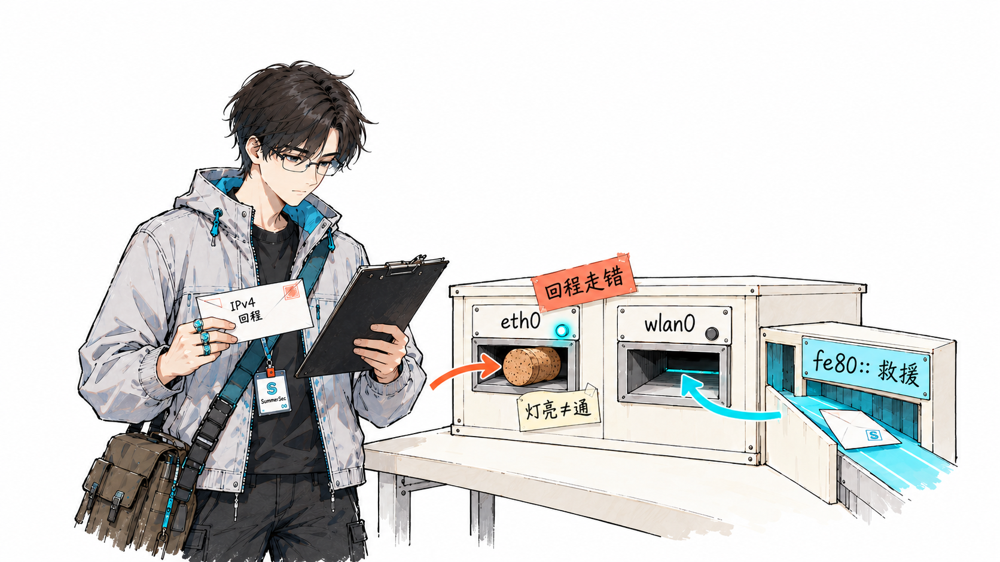

---
tags:
- blog-comments
---

# 树莓派旁路由实战：Mihomo 透明代理与双 Wi-Fi 故障备用

一开始，这件事听起来很简单：家里所有连到华为 AX3 Pro 的设备，都能自动走代理，手机、电脑、平板不用一台台去填代理地址。

真正动手之后才发现，装 Clash 只是最容易的一步。后面等着我的是两个 DHCP 服务器互抢、客户端死守旧 IP、Docker 默认丢转发、同网段双网卡的 ARP 乱窜、IPv6 悄悄绕过代理，以及“服务显示 ACK 了但手机根本没用”的经典错觉。最后稳定下来的方案保留华为路由器的 DHCP，让树莓派只做 DNS 和透明代理；早期 DHCP 接管实验继续作为踩坑记录保留，但不再是当前推荐架构。

树莓派当然可以做 DHCP，这次仍把 DHCP 留给华为，是为了给家庭网络留一条业务上的备用路径：只要 AX3 Pro 还能正常拨号和供电，即使树莓派整机、服务、供电、网络链路或网线出故障，其他家人的设备仍能从华为自动拿到地址、网关和 DNS，继续正常上网。旁路由只影响主动选择它的设备，排查时也不会把全家的地址分配和上网入口一起绑定到 Pi；这是故障隔离设计，不是对树莓派硬件可靠性的判断。

这篇文章把最终的架构、关键配置和踩坑过程完整记一遍。具体节点名、订阅地址、控制器密钥和设备的 MAC 都做了脱敏，只保留可复现的思路。

## 一、目标与最终拓扑

目标很明确：

- 华为 AX3 Pro（`192.168.3.1`）继续做主路由、NAT、Wi-Fi 和 DHCP，IPv6/RA 保持关闭；
- 树莓派 5 做旁路由，负责透明代理和 DNS，不接管 DHCP；
- `eth0` 使用静态 `192.168.3.27/24`，默认网关和本机 DNS 都指向 `192.168.3.1`；
- `wlan0` 只做管理，使用华为 DHCP，当前租约曾为 `192.168.3.7`，这是动态地址，不是固定入口；
- 华为使用两个名称不同的 Wi-Fi SSID 作为普通/备用入口和按需旁路由入口（下文用 2.4G/5G 举例，频段可以互换）；
- 普通/备用 SSID 上的设备自动从华为 DHCP 获取地址、网关和 DNS `192.168.3.1`，需要走旁路由的 SSID 上的设备再自行把网关和 DNS 设为 `192.168.3.27`；
- 出问题时能回滚，不能把家里的网搞成一次性工程。

最终拓扑大概是这样：

```text
Internet
   │
华为 AX3 Pro（192.168.3.1，开启 DHCP，关闭 IPv6/RA）
   │ LAN
   ├── 树莓派 5 / sumpi
   │     ├── eth0 192.168.3.27/24（静态，网关/DNS 为 .1，路由 metric 100）
   │     ├── wlan0 DHCP（仅管理，当前租约示例为 .7，默认路由 metric 600）
   │     ├── Mihomo
   │     │     ├── mixed-port 7890
   │     │     ├── tproxy-port 7894
   │     │     └── DNS 127.0.0.1:1053
   │     ├── dnsmasq（DNS-only）
   │     │     └── 监听 192.168.3.27:53，转发到 127.0.0.1:1053
   │     └── nftables TPROXY + 策略路由
   ├── 华为 Wi-Fi 普通/备用 SSID（示例：2.4G）
   │     └── 客户端自动 DHCP，网关/DNS 为 .1
   └── 华为 Wi-Fi 旁路由 SSID（示例：5G）
         └── 选中的客户端手动设置网关/DNS 为 .27
```

树莓派本身不发射 Wi-Fi，两个入口都由华为发射。上面的 2.4G/5G 只是便于识别的示例，频段可以对换；关键是先关闭“5G 优选/双频合一”或确保两个 SSID 名称不同，再在客户端系统里分别保存自动 DHCP 和手动网关/DNS 配置。华为对含 AX3 Pro 机型的分频说明可参考[官方文档](https://consumer.huawei.com/cn/support/content/zh-cn00414341/)，具体菜单名称以当前固件为准。频段本身不会让 AX3 Pro 自动下发两套不同的网关或 DNS。只有选中的客户端把网关和 DNS 改成 `.27`，树莓派才会接住它们的 DNS 和透明流量，普通/备用入口上的设备仍由 `.1` 直接提供网络。

### 接口地址必须在 Pi 自己的网络配置里声明

拓扑里写“`eth0` 静态 `.27`”并不等于 dnsmasq 的 `dhcp-host` 预留。当前实际使用的是 systemd-networkd 的 drop-in，覆盖 `/run/systemd/network/10-netplan-eth0.network`：

```ini
# /etc/systemd/network/10-netplan-eth0.network.d/90-sumpi-gateway.conf
[Match]
Name=eth0

[Network]
DHCP=no
Address=192.168.3.27/24
IPv6AcceptRA=no
DNS=192.168.3.1

[Route]
Gateway=192.168.3.1
Metric=100
```

`wlan0` 一直从华为 DHCP 获取管理地址；`.25` 和本次排查时拿到的 `.7` 都是历史租约，不是固定入口，默认路由 metric 为 `600`。若只看到路由器识别到 Pi 的 MAC、却没有 DHCP 租约，先确认 `.27` 的静态配置和 `eth0` carrier，再判断是不是“没有 IP”。

## 二、为什么不是“每台设备填代理”

最直接的做法是给每台设备手动填 HTTP/SOCKS 代理。但这样有几个问题：

- 手机、电视、平板、游戏机，并不是每台都能方便地设置代理；
- App 不一定会遵守系统代理，尤其是自己实现网络栈的应用；
- 设备一多，配置和维护成本会迅速失控。

旁路由的吸引力在于：需要代理的客户端只需把网关和 DNS 指向树莓派，应用本身不用填 HTTP/SOCKS 代理。

早期尝试曾经让树莓派接管 DHCP，但两个 DHCP 服务器互抢，恢复成本高。树莓派具备做 DHCP 的能力，当前仍保留 AX3 Pro DHCP，是为了让普通/备用 SSID 在 Pi 整机、服务、供电、网络链路或网线出问题时继续由华为提供地址、网关和 DNS；这把故障影响限制在选择旁路由的设备，而不是让 Pi 成为全家的单点。地址分配和透明代理拆开，也避免为了修改网关而替换家庭网络的基础设施。

两个 SSID 只是让客户端配置易于识别和切换，不能理解成 AX3 Pro 会按频段自动下发不同的 DHCP 网关或 DNS。下面的名称仅为示例，实际使用前要确保 SSID 不同；手机或其他系统能否按 SSID 保存独立的手动网关/DNS，要以系统能力为准。

| 入口（示例） | 客户端网络配置 | 用途与故障时动作 |
| --- | --- | --- |
| `AX3-Home-2G`（普通/备用） | 自动 DHCP，预期地址、网关和 DNS 由华为提供，网关/DNS 为 `.1` | 普通直连；Pi 异常时切到这里绕过 Pi |
| `AX3-Proxy-5G`（按需旁路由） | 在客户端网络设置中手动把网关和 DNS 设为 `.27`；若系统因此要求静态模式，保留有效且不冲突的客户端 IP 和 `/24` 前缀，不能把客户端自己的 IP 填成 `.27` | 只让选中的设备经过 Pi；Pi 异常时切回备用 SSID |

这里的 `2G`/`5G` 与频段不是硬绑定，两个 SSID 也不提供自动故障切换。旁路由失效时，先把需要联网的设备切到自动 DHCP 的备用 SSID，确认网关/DNS 已回到 `.1`，再通过 SSH 或 IPv6 链路本地地址排查 Pi；这只能绕过 Pi，不能解决 AX3 Pro 或上游宽带本身的故障。



_图：网关和 DNS 由客户端分别保存并手动切换，SSID 只是便于识别的入口，不由频段自动分配。_

## 三、组件和端口

这台树莓派 5 跑的是 Ubuntu，代理内核用 `clash-for-linux` 项目安装的 Mihomo。核心端口：

- `7890`：mixed 端口，HTTP/SOCKS 代理，方便本机调试；
- `7894`：TPROXY 端口，局域网客户端的透明流量从这里进入 Mihomo；
- `1053`：Mihomo 的本地 DNS，只监听 `127.0.0.1`；
- `9090`：external controller，面板和 API。

当前 `sumpi-dns`、`clash-for-linux` 和 `sumpi-gateway-netfilter` 均处于 active，Mihomo controller 仍绑定 `.27`；`53/7890/7894/9090` 可用，DNS 查询成功。这里的“active”仍要和实际监听端口分开验证，尤其是 `eth0` 没有 carrier 时。

面板地址是：

```text
http://<树莓派地址>:9090/ui/
```

控制器密钥在运行时配置的 `secret:` 字段里。这个面板**只应该留在局域网**，不要做公网端口映射；它控制的是整条代理链路，不是普通网页。

本机可以先验证代理本身是否正常：

```bash
curl -x http://127.0.0.1:7890 -I https://www.google.com
curl -x http://192.168.3.27:7890 -I https://x.com
```

只要这一步不通，后面的 TPROXY、DHCP、IPv6 都先不用查。

## 四、TPROXY：不改应用，把流量送进代理

透明代理有几种常见做法：

- **HTTP 代理**：应用必须支持，覆盖不全；
- **REDIRECT/NAT**：改写目标地址，容易丢掉原始目标信息；
- **TUN**：新建虚拟网卡，接管路由，功能强但边界更大；
- **TPROXY**：保留原始目标地址，把匹配到的 TCP/UDP 透明地交给本地监听端口。

这套方案选的是 TPROXY。树莓派只处理从 `eth0` 进来的局域网流量，本机自己的流量不经过这条链路，避免代理把 Socks 出口又绕回自己。

核心 nftables 规则（脱敏）：

```nft
table ip sumpi_tproxy {
    set private4 {
        type ipv4_addr
        flags interval
        elements = {
            10.0.0.0/8,
            100.64.0.0/10,
            127.0.0.0/8,
            169.254.0.0/16,
            172.16.0.0/12,
            192.168.0.0/16,
            224.0.0.0/4,
            240.0.0.0/4
        }
    }

    chain prerouting {
        type filter hook prerouting priority mangle
        policy accept

        # 局域网、回环、多播、链路本地不碰
        iifname "eth0" ip saddr 192.168.3.0/24 ip daddr @private4 return

        # 当前 AX3 保留 DHCP；这里不处理 DHCP 广播
        iifname "eth0" udp dport 67 return

        # 其余局域网 TCP/UDP 全部交给 Mihomo
        iifname "eth0" ip saddr 192.168.3.0/24 \
            meta l4proto { tcp, udp } \
            tproxy to :7894 meta mark set 0x2333 counter
    }
}
```

注意 `198.18.0.0/15` 没有放进 `private4`。这是 Mihomo fake-IP 常用的地址段，必须让客户端的 fake-IP 连接进入 TPROXY，而不是被当成私有地址直连。

配套的策略路由：

```bash
ip rule add pref 100 fwmark 0x2333/0xffff lookup 233
ip route add local 0.0.0.0/0 dev lo table 233
```

这两条的意思是：被 nftables 打上 `0x2333` 标记的包，不再走正常路由，而是送到本机 `lo`，由监听 `7894` 的 Mihomo 接住。

这里我特意把它做成独立的 systemd oneshot 服务：启动时先做 preflight，确认表名、规则优先级和路由表都没被占用，再应用规则；停止时只删除自己创建的对象，不做全局 flush。这样即使重启失败，也不会误删别的网络配置。

这段描述的是现有 netfilter 配置的工作方式；本次恢复没有新增策略路由，也没有把 controller 绑定改到别的地址。



_图：TPROXY 接管的是匹配到的透明流量，具体走 DIRECT 还是代理仍由 Mihomo 规则决定。_

## 五、DNS-only 接入：DHCP 留在华为

当前 `/etc/sumpi-gateway/dnsmasq.conf` 已替换为既有 `dnsmasq-dns-only.conf` 的内容，dnsmasq 只做 DNS 转发：

```ini
except-interface=wlan0
bind-dynamic
listen-address=192.168.3.27
port=53
no-resolv
no-poll
server=127.0.0.1#1053
cache-size=1000
```

当前配置明确移除了 `dhcp-range`、`dhcp-option`、`dhcp-authoritative`、`dhcp-leasefile` 和所有 `dhcp-host`。`sumpi-dns` 处于 active，UDP 53 可用，UDP 67/547 没有监听；DNS 查询成功。AX3 Pro 保持 DHCP 开启，IPv6/RA 保持关闭。

`except-interface=wlan0` 会排除树莓派自身 `wlan0` 上的 dnsmasq 监听（包括 DNS 和 DHCP），并不妨碍 AX3 Wi-Fi 客户端经由有线 LAN 访问树莓派 `eth0` 的 `.27:53`。当前没有 DHCP 服务；树莓派的 `wlan0` 管理地址由 AX3 DHCP 分配，当前租约 `.7` 只是一次动态结果；它既不是固定地址，也不是手机的网关。

客户端接入分两类（不同 SSID 的使用约定见第二节）：

- 普通/备用 SSID 上的客户端继续从 AX3 DHCP 获取地址、网关和 DNS `.1`；
- 旁路由 SSID 上需要走代理的客户端把网关和 DNS 都改为 `192.168.3.27`；如果系统因此切换到静态网络模式，保留一个不冲突的 `192.168.3.0/24` 地址，不要把客户端自己的 IP 也填成 `.27`。

`192.168.3.27` 是 Pi `eth0` 的本机静态地址，不是 DHCP 租约。应在 AX3 DHCP 池中排除或保留 `.27`，避免分配给别的设备；这篇文章不假设路由器已经替你完成了这项保留。

早期的 DHCP 接管配置和失败现象放在下面几节，都是历史实验记录，不是当前应启用的配置。

## 六、历史踩坑一：两个 DHCP 服务器互抢

这是早期 DHCP 接管实验里最隐蔽、也最伤的一个问题；当前 AX3 DHCP 保持开启，Pi 不再运行 DHCP。

现象：

- 手机在 `.50` 和 `.53` 之间来回跳；
- 有时能上网，有时 x.com/Google 又打不开；
- Pi 的 dnsmasq 日志里反复出现：

```text
DHCPREQUEST 192.168.3.53
DHCPNAK 192.168.3.53 address not available
DHCPREQUEST 192.168.3.50
DHCPNAK 192.168.3.50 wrong server-ID
```

抓包之后才看明白：华为的 DHCP 其实还在工作。它和树莓派的 dnsmasq 各自给手机发租约，又各自 NAK 对方的租约；手机在两个服务器之间被来回拉扯。树莓派开了 `dhcp-authoritative` 之后，这种情况会更严重，因为它会把别人发的租约也当成“地址不可用”直接 NAK。

抓 DHCP 包的命脉命令：

```bash
sudo tcpdump -i eth0 -n -e -vv 'udp port 67 or udp port 68'
```

重点看三个字段：

- `DHCP-Message`：Discover / Offer / Request / ACK / NAK；
- `Server-ID`：这个回复到底来自哪个 DHCP 服务器；
- `Requested-IP`：客户端坚持要哪个地址。

只要看到两个不同的 `Server-ID` 在同一个交换里出现，就不用再猜了：先保证**全网只有一个 DHCP 服务器**。

当时的结论很朴素：不是 TPROXY 的错，也不是 mihomo 的错，是实验网络里有两个“权威”在发地址。当前方案直接让 AX3 保留唯一 DHCP，避免再次进入这个状态。

## 七、历史踩坑二：DHCP 池不覆盖旧租约

第二个坑紧跟着来。

为了让客户端换到树莓派，我一开始把池子设为 `192.168.3.100-199`。但家里设备之前的地址是华为 DHCP 发的，比如 `.53`、`.34`，客户端重启网络后会先尝试**续租自己记得的旧地址**（INIT-REBOOT），直接发 `DHCPREQUEST` 给旧地址。

树莓派的池子不包含这些地址，于是回 NAK。理想情况下，客户端收到 NAK 后会重新 DISCOVER，拿一个新地址；但现实里，有些手机和 IoT 设备会在“请求旧地址 → 被 NAK → 再 DISCOVER → 又请求旧地址”之间循环，迟迟不肯接受新地址。

解决方式不是继续跟客户端较劲，而是把池子改成**迁移友好**的范围：

```ini
dhcp-range=192.168.3.2,192.168.3.254,255.255.255.0,1h
```

在当时的 DHCP 接管设计里，需要把基础设施地址单独保留：

- `.1`：路由器；
- `.25`：早期拿到过的树莓派 wlan0 管理租约；当前 wlan0 仍由 AX3 DHCP 动态分配；
- `.27`：树莓派 eth0 网关地址；
- `.54`：手机固定地址；
- 其他需要固定 IP 的设备，用 `dhcp-host` 预留。

这样客户端申请旧地址时，只要在池子里且没被占用，就能直接 ACK；它会保留原来的 IP，同时从 ACK 里拿到新的网关/DNS `.27`。这段行为只适用于当时的 DHCP 接管实验，当前客户端改为手动选择网关/DNS。

当然，池子开大之后要小心静态地址冲突。路由器、树莓派、NAS、打印机这类设备，最好都显式加 `dhcp-host` 保留。

## 八、历史踩坑三：`dhcp-broadcast` 反而让鸿蒙忽略 OFFER

在还没发现“两个 DHCP 服务器互抢”之前，我一度以为是 OFFER 没有送到手机，于是给 dnsmasq 加了：

```ini
dhcp-broadcast
```

它的作用是强制 DHCP 回复使用广播。对某些跨网桥、跨 VLAN 的场景确实有用，但在这台鸿蒙手机上，结果很反直觉：手机仍然只发 DISCOVER，不进入 REQUEST。抓包看，Pi 的 OFFER 已经发出去了，手机就是不接。

后来在那次 DHCP 接管实验里把华为 DHCP 彻底关掉、并且去掉 `dhcp-broadcast`，dnsmasq 才回到默认行为：客户端没设置广播标志就发单播 OFFER，手机正常走完 `REQUEST → ACK`。当前架构不启用这套 DHCP 配置。

这件事的教训是：**不要在没定位根因之前叠加“看起来有用”的兼容选项**。`dhcp-broadcast` 没有错，它只是被用在了错误的阶段。等网络里只剩一个 DHCP 服务器后，默认行为往往就是最兼容的。

## 九、踩坑四：Docker 的 `FORWARD` 默认 DROP

透明代理跑通之后，一个新的问题出现了：走代理的网站正常，但局域网内的一些直连流量会断。

原因是树莓派上装了 Docker。Docker 会把 iptables 的 `FORWARD` 链策略设成 `DROP`，只给自己需要的流量开口子：

```text
-P FORWARD DROP
-A FORWARD -j DOCKER-USER
-A FORWARD -j DOCKER-FORWARD
```

TPROXY 把代理流量重定向到了本机，不经过 `FORWARD`；但被 `private4` 排除的局域网流量（比如访问 `.1` 或其他内网设备）仍然要转发，就会被这条默认策略丢掉。

修复方式不是把全局策略改成 `ACCEPT`，而是只给有线局域网加一条明确规则：

```bash
iptables -I FORWARD 1 \
  -i eth0 -o eth0 -s 192.168.3.0/24 \
  -j ACCEPT
```

这条规则只放行 `eth0` 进、`eth0` 出的局域网流量，不影响 Docker 自己的隔离。它被写进了 netfilter 的 apply 脚本，服务和回滚脚本都会管理它。

## 十、踩坑五：同网段双网卡与 ARP flux

树莓派有两个接口：

- `eth0`：`192.168.3.27`，有线网关；
- `wlan0`：从 AX3 DHCP 获取管理地址，曾拿到 `.25`、本次又拿到 `.7`；两者都是租约，不是固定地址。

它们恰好在同一个 `/24` 里。Linux 默认的 ARP 行为（`arp_ignore=0`）允许它从任意接口回答本机地址的 ARP 请求。也就是说，客户端问“谁是 `192.168.3.27`”，树莓派可能从 `wlan0` 回一个 ARP，客户端就把网关解析到 `wlan0` 的 MAC。

后果很隐蔽：流量从 `wlan0` 进来，而 TPROXY 规则只匹配 `iifname "eth0"`，于是这部分流量绕过代理，接着又被 `FORWARD` 策略丢掉，表现就是“有时能上、有时不能上”。

修复：

```ini
# /etc/sysctl.d/90-sumpi-gateway.conf
net.ipv4.conf.all.arp_ignore=1
net.ipv4.conf.all.arp_announce=2
net.ipv4.conf.eth0.arp_ignore=1
net.ipv4.conf.eth0.arp_announce=2
net.ipv4.conf.wlan0.arp_ignore=1
net.ipv4.conf.wlan0.arp_announce=2

# 顺手关掉 ICMP redirect，避免客户端被教着绕过网关
net.ipv4.conf.all.send_redirects=0
net.ipv4.conf.default.send_redirects=0
net.ipv4.conf.eth0.send_redirects=0
net.ipv4.conf.wlan0.send_redirects=0
```

`arp_ignore=1` 的含义是：只回答“请求的地址确实配在收到请求的那个接口上”的 ARP。这样 `.27` 只会在 `eth0` 上被回答，当前动态管理地址（例如 `.7`）只会在 `wlan0` 上被回答，客户端不会再把网关解析到错误的接口。

如果不需要 Wi-Fi 管理，最彻底的办法是把 `wlan0` 关掉，或者把它放到另一个网段。保留同网段管理地址时，上面这组 sysctl 基本是必需项。

### 本次 eth0 失联复盘

这次排查暴露了几个容易被“服务 active”掩盖的状态：

- 最初 Pi 没有开机，Pi5 的 USB-A 主机口对接也不能提供登录链路；
- `eth0` 处于 `NO-CARRIER` 时，静态 `.27` 尚未就绪，netfilter 的 preflight 会失败；服务没有自动重试，controller 仍绑定 `.27` 并不代表 `9090/7890/7894` 已经监听；
- 插入网线、看到链路灯亮后，仍一度出现双向 IPv4 失联：定向从 `eth0` 到 `.1`/`.22` 的 ping 失败，而 `wlan0` 成功。同网段双网卡的默认路由选择会让 wlan0 的 IPv4 回程也走 eth0；当时 `rp_filter=2` 是宽松模式，不能据此把问题武断归因于严格反向路径过滤，也不能仅凭现象断定网线或驱动损坏；
- 最终通过 wlan0 的 IPv6 链路本地地址恢复 SSH。路由器关闭 IPv6/RA 不会关闭接口自己的 `fe80::/10` 地址；这类地址只在本链路有效，可参考 [RFC 4291 §2.5.6](https://www.rfc-editor.org/rfc/rfc4291.html#section-2.5.6)。Windows 使用时要带作用域，例如 `fe80::1234:5678:9abc:def0%12`。

OpenSSH 配置里 `%` 还会参与 token 展开，Windows 作用域应写成双百分号：

```sshconfig
Host sumpi6
    HostName fe80::1234:5678:9abc:def0%%12
    User sum
    HostKeyAlias 192.168.3.27
```

这里的 IPv6 只是格式示例，不从真实 MAC 推导地址；`HostKeyAlias 192.168.3.27` 表示复用 `known_hosts` 中同一台 Pi 的 IPv4 地址条目，实际使用前应确认该条目确实属于这台 Pi，不能任意写一个别名，也不要用 `StrictHostKeyChecking=no` 绕过校验。`%%` 的规则见 [OpenSSH ssh_config TOKENS](https://man.openbsd.org/ssh_config#TOKENS)。

随后正常重启树莓派一次，`boot_id` 已变化；重启后 `eth0`、`wlan0` 都能 ping 通 `.1`，服务和端口恢复，`GET /ui` 返回 `200`（`HEAD` 返回 `405` 不代表面板失效），仍无 DHCP 监听。本次没有改 controller 绑定、没有新增策略路由，也没有添加 service 自动重试配置。



_图：链路本地 IPv6 这里只用于同链路 SSH 救援管理，不提供备用上网；IPv4 双网卡回程仍需单独排查。_

## 十一、踩坑六：IPv6 绕过 TPROXY

这是整次排障里最容易被忽略的一层。

这套 TPROXY 只处理 IPv4。只要客户端还能拿到一个全局 IPv6 地址，而目标站点又有 AAAA 记录，它就可能直接走 IPv6 出去，完全不经过树莓派。

几个容易误判的点：

- Mihomo 的 `dns.ipv6: false` 只影响**发到 Pi 的 DNS 查询**，不代表客户端没有别的 IPv6 来源；
- 路由器通过 RA/RDNSS 下发的 IPv6 地址和 DNS，手机可能优先使用；
- 手机开启 Private DNS/DoH 时，也可能绕过 Pi 的 DNS，拿到 AAAA；
- 部分 App 甚至会走移动数据，连 Wi-Fi 网关都不看一眼。

这次的症状是：Pi 上能看到手机大量的国内 IPv4 流量在走代理，但 x.com/Google **一个 IPv4 连接都没有**；手机 Wi-Fi 详情里有一个 `2409:` 开头的全局 IPv6 地址。关掉 AX3 的 IPv6/RA、重新连接手机之后，全局地址消失，只剩本链路使用的 `fe80:`，问题才彻底消失。`fe80:` 仍然存在是正常现象，不等于 IPv6/RA 又被打开。

所以排查顺序应该是：

1. 看客户端 Wi-Fi 详情里有没有全局 IPv6；
2. 看路由器 IPv6/RA 是否真的关闭；
3. 看客户端是否开了 Private DNS、VPN、加速器；
4. 再看移动数据是否在分流部分 App。

如果路由器无法关闭 IPv6，那就要么让 Pi 接管 IPv6（RA + IPv6 TPROXY，工作量大得多），要么在客户端侧限制 IPv6。只靠 `dns.ipv6: false` 是不够的。

## 十二、历史踩坑七：DHCP ACK 了，不代表客户端用了

有一个瞬间很容易让人误判。在早期 DHCP 接管实验里，Pi 的日志明确显示：

```text
DHCPREQUEST 192.168.3.53 <手机 MAC>
DHCPACK 192.168.3.53 <手机 MAC>
```

租约文件也写进去了，但手机的 Wi-Fi 详情里网关和 DNS 仍然是 `.1`，x.com 还是打不开。

原因不在 DHCP 服务器，而在客户端：

- 手机可能还保留着旧的静态配置；
- 手机的 DHCP 客户端可能拿到了 ACK，但界面/系统没有把网关/DNS 应用到这个网络；
- 手机可能还有其他接口（热点、信号桥）在用另一套网络配置；
- 或者路由器 DHCP 其实没关干净，手机又拿到了 `.1` 的租约。

最后的排查方法很土但有效：**直接看客户端 Wi-Fi 详情里的 IP / 网关 / DNS / IPv6**，不要只看 Pi 的 ACK。Pi 的租约文件证明“服务器发出了什么”，客户端详情证明“客户端实际用了什么”，这两件事必须分开验证。

当时手机坚持保留旧地址 `.53`，实验阶段曾把它固定成 `.54`，并在手机上设置静态 `.54` + 网关/DNS `.27`，才把状态稳定下来。这个结果属于旧 DHCP 接管路径；当前方案不再让 Pi 发租约，客户端按需手动覆盖网关/DNS，自己的 IP 仍由 AX3 DHCP 或客户端静态配置决定。

## 十三、自动切换最优新加坡节点

代理链路稳定之后，新的需求是：国外流量不要死绑一个节点，节点变慢或挂掉时自动换。

Mihomo 的 `url-test` 组适合做这件事。原来 `🔰国外流量` 是一个 `select` 组，手动选了一个新加坡节点；我加了一个只包含新加坡节点的自动组：

```yaml
proxy-groups:
  - name: "♻️新加坡自动"
    type: url-test
    url: "http://www.gstatic.com/generate_204"
    interval: 300
    tolerance: 50
    lazy: true
    expected-status: 204
    proxies:
      - "<SG-01>"
      - "<SG-02>"
      - "<SG-03>"
```

然后把 `♻️新加坡自动` 放到 `🔰国外流量` 的选择列表里，并设为默认：

```text
🔰国外流量 → ♻️新加坡自动 → <当前最优的新加坡节点>
```

`url-test` 会定期请求 `generate_204`，按延迟和可用性选一个节点。几个参数的含义：

- `interval: 300`：每 5 分钟测一次；
- `tolerance: 50`：延迟差小于 50ms 时不来回切，避免抖动；
- `lazy: true`：没有使用时不必持续测速；
- `expected-status: 204`：只有返回 204 才算健康。

如果没有显式列出节点，也可以用 `include-all-proxies: true` 加 `filter` 做批量筛选。但要注意：

- 不要把“直连”类节点放进自动组，否则可能选中一个不代理的出口；
- 订阅更新/运行时配置重新生成时，这个手动加的组可能会被覆盖，最好保留配置文件备份；
- 自动组解决的是“节点选择和故障切换”，不改变规则分流本身。

验证方法是在面板或 `/connections` API 里看连接链，正常应该类似：

```text
[<当前新加坡节点>, ♻️新加坡自动, 🔰国外流量]
```

如果链里只有具体节点、没有自动组，说明选择器还停在手动节点上。

## 十四、验证清单

这套东西涉及 DNS、地址、路由、防火墙和客户端五层，出问题时不要凭感觉，按层验证。尤其要把“systemd active”和“端口正在监听”分开看：eth0 没有 carrier 时，netfilter preflight 可能失败，controller 仍绑定 `.27` 也不代表端口可用。

**服务层**

```bash
systemctl is-active clash-for-linux sumpi-dns sumpi-gateway-netfilter
systemctl is-enabled clash-for-linux sumpi-dns sumpi-gateway-netfilter
ip -br -4 addr show dev eth0
ip -br -4 addr show dev wlan0
ip route
iw dev wlan0 link
```


_图：服务状态只能说明进程或 unit 的状态，仍需用地址、端口和 HTTP 请求验证实际可用性。_

**TPROXY 层**

```bash
ip rule
ip route show table 233
nft list table ip sumpi_tproxy
iptables -S FORWARD | head
```

**DNS 层**

```bash
dig @192.168.3.27 www.google.com
dig @192.168.3.27 AAAA x.com
dig @127.0.0.1 -p 1053 www.google.com
ss -lunp | grep -E ':(53|67|547)\b'
```

当前预期是 UDP 53 有监听，UDP 67/547 没有监听。Pi 的 `eth0` 静态地址必须为 `.27/24`，网关和本机 DNS 为 `.1`；`wlan0` 地址由 AX3 DHCP 分配，`.25`、`.7` 都只能当历史租约看待。

**代理层**

```bash
curl -x http://192.168.3.27:7890 -I https://www.google.com
curl -x http://192.168.3.27:7890 -I https://x.com
curl -fsS -o /dev/null -w '%{http_code}\n' http://192.168.3.27:9090/ui/
```

面板用 `GET /ui/` 验证，返回 `200` 即可；某些实现对 `HEAD` 返回 `405`，这不等于面板挂掉。

**透明转发层**

可以建一个临时的 network namespace + veth，模拟一个局域网客户端，给它一个假 IP 和默认路由，再用独立的 nft 规则把流量 tproxy 到 Mihomo，最后用 `curl --resolve` 访问 fake-IP，不设置任何代理变量，期望返回 204。这个测试能证明“客户端 → TPROXY → Mihomo”这条链路是通的，而不只是 HTTP 代理端口能连。

**客户端层**

- 需要走旁路由的客户端是否把网关/DNS 手动设为 `192.168.3.27`，且自己的 IP 没有误填成 `.27`；
- 其他客户端是否仍从 AX3 DHCP 获得网关/DNS `.1`；
- IPv6 是否只剩 `fe80:`；
- 是否能直接打开 `https://www.google.com` 和 `https://x.com`；
- 出问题时在 Pi 上抓 `tcpdump`，看客户端到底有没有把包发过来、DNS 发给了谁。

对单一目标的超时要和整条出口分开判断。本次 `118.193.240.37:443` 从 Pi 以源地址 `.27`、网关 `.1` 发起 TCP 连接，两次约 5 秒超时；Pi 直连 `https://www.baidu.com` 返回 `200`，Windows 直接连同一目标也约 4 秒超时，其他访问正常。因此只能记为单一目标或路径不可达，不能据此断言旁路由出口整体故障，也不能直接推出必须修改代理规则。当前规则中保留 `RULE-SET,cncidr,DIRECT,no-resolve`，遇到类似现象先做对照测试。

## 十五、回滚与维护

旁路由最怕的是“改完自己都回不去”。这套方案从一开始就准备了回滚：

```bash
sudo /usr/local/libexec/sumpi-gateway-rollback --confirm
```

回滚脚本会恢复安装时的文件备份，停止 dnsmasq/netfilter，并删除自己创建的 nft 表、策略路由和 FORWARD 规则。它对应的是早期 DHCP 接管实验；当前 AX3 DHCP 本来就保持开启，IPv6/RA 按当前网络策略保持关闭，不要把“回滚后重新打开 IPv6”当成当前方案的必需步骤。

日常维护要注意：

- 路由器重启后，确认 DHCP 仍开启、IPv6/RA 仍按预期关闭；
- 维持普通/备用与旁路由两个不同的 SSID，并确认客户端分别保存了自动 DHCP 或手动网关/DNS；Pi 异常时先切到自动 DHCP 的备用 SSID，确认网关/DNS 为 `.1`，再排查 Pi；
- 修改运行时配置前先备份，订阅更新可能覆盖 `config.yaml`；
- 重启 `clash-for-linux` 会连带重启 `sumpi-gateway-netfilter`，重启后检查 TPROXY 和 FORWARD 是否都在；
- systemd `ExecStart` 指向的脚本必须可执行。曾经因为把脚本改成 `0644`，服务报 `203/EXEC`，表现为“配置全对但 netfilter 起不来”；
- 控制面板和 `secret` 不要暴露到公网，也不要把订阅地址、节点密钥写进博客或提交到仓库。

## 十六、经验总结

如果只让我留下几条结论，会是这些：

1. **当前只保留一个 DHCP 服务器。** AX3 DHCP 保持开启，Pi 的 dnsmasq 只监听 DNS；两个 authoritative DHCP 互抢是历史实验的故障来源。这样在 AX3 仍能拨号和供电时，Pi 故障不会切断其他家人的自动地址分配和正常上网。
2. **Pi 的静态地址必须由 Pi 自己配置。** `eth0=.27/24`、网关/DNS `.1` 写在 networkd 配置里；dnsmasq 的 `dhcp-host` 预留不能替代静态地址。
3. **`.27` 应在 AX3 DHCP 池中排除或保留。** `wlan0` 的 `.25`、`.7` 都是动态租约，不能当固定管理入口，更不能当手机网关。
4. **客户端按需手动选择旁路由。** 用两个名称不同的 SSID 作为普通/备用和旁路由入口；选中的设备把网关/DNS 改成 `.27`，自己的 IP 保持有效且不冲突，其他设备或故障时切回备用 SSID 使用 `.1`。
5. **TPROXY 只处理它匹配到的地址族和接口。** IPv6、`wlan0`、本机流量，都可能绕过你以为已经覆盖的规则；服务 active 也不等于端口已经监听。
6. **Docker 的 `FORWARD DROP` 会咬人。** 加一条窄的 accept，不要动全局策略。
7. **同网段双网卡要收敛 ARP 和路由。** `arp_ignore=1`、`arp_announce=2`，并给 eth0/wlan0 设置明确的 metric。
8. **IPv6/RA 关闭不等于链路本地 IPv6 消失。** `fe80::` 可作为同链路的恢复入口，Windows 和 OpenSSH 都要正确处理作用域 `%ifIndex`。
9. **保留回滚路径和配置备份。** 旁路由不是一次性脚本，路由器固件更新、订阅更新、系统重启都会改变状态。
10. **节点自动切换和流量分流是两件事。** `url-test` 解决“选哪个节点”，规则解决“哪些流量走代理”。

最后，当前方案的前提是：AX3 DHCP 保持开启，IPv6/RA 保持关闭；普通/备用与旁路由入口使用两个名称不同的 SSID，前者自动使用 `.1`，后者由选中的客户端手动把网关/DNS 指向 `.27`；Pi 的 `eth0` 有明确的静态 `.27/24` 配置，dnsmasq 只提供 `.27:53` 的 DNS。如果以后重新尝试 DHCP 接管，必须把它当成另一套方案，先准备单独的回滚路径和抓包验证。
